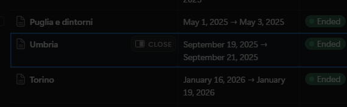
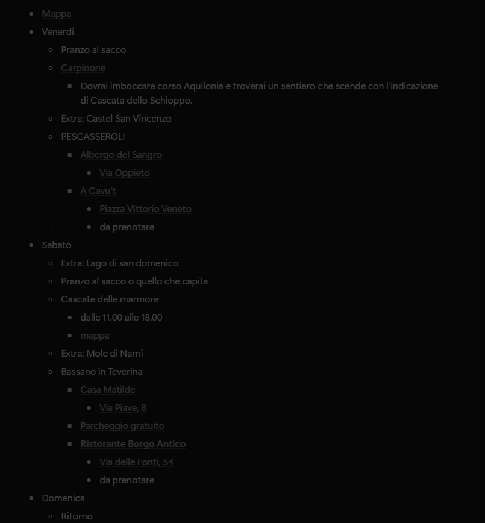

## Risposte a Domande aperte

- Il modello "itinerario → viaggio" (un viaggio come istanza di un itinerario, in programma / in corso / trascorso): il viaggio copia l'itinerario o lo referenzia? Le modifiche durante il viaggio (prezzi reali, foto, cambi di programma) dove vanno?
    - diciamo che l'ideale sarebbe avere l'itinerario come un "blueprint" dal quale creare il viaggio, quindi è una base sul quale poi si crea il viaggio e tutte le modifiche vanno solo sul viaggio in questione. Poi da quel viaggio modificato si può tirare fuori un nuovo itinerario. E' tutto in analisi ovviamente quindi vediamo pure strada facendo cosa ha più senso fare.
- Condivisione: gli itinerari sono pubblici, visibili agli amici o privati per scelta? Gli altri possono copiarli?
    - risposta in parte prima, per adesso tutto visibile e copiabile, poi vediamo se avere delle parti "private", nel copiare il viaggio si riporterebbe solo i luoghi, gli spostamenti e le attività ogni foto o valorizzazione andrebbe invece non copiata. (anche questo capiamolo bene strada facendo)
- Il documento JSON unico regge la condivisione e i viaggi, o serve un modello relazionale almeno per utenti, itinerari e viaggi?
    - mah, forse ha senso avere un modello relazionale, magari capiamo strada facendo
- Quale schema DB c'è oggi su Supabase in produzione (tabelle, policy, bucket `Photos`)?
    - c'è qualche comando di supabase che ti può dare uno snapshot dell'architettura? così sicuro non mi scordo niente (tanto dobbiamo creare la "copia docker locale")

## Architettura

- Opzioni per l'architettura -> va bene la scelta 1 di sito statico più supabase, va bene che si "spenga" se non viene usato, in parte è anche giusto così
- la parte multiutente è stata solo abbozzata quindi sì probabilmente va rifatto un po' tutto lì

## Notion

- di base ho una lista di pages (una per viaggio) messe in lista con le date e lo stato (se è in programmazione, finita la programmazione, viaggio fatto) 
- questo è un esempio di page (dovrebbe essere lo stesso viaggio che ho hardcodato col json quindi puoi fare anche delle comparazioni con quello). Qui c'è praticamente tutto:
    - dettaglio del programma giorno per giorno
    - link a maps per ogni luogo, bnb, ristorante, etc
    - note
    - eventuali stati (tipo ristoranti da prenotare, hotel da saldare, etc)
    - eventualmente spese già affrontate e da affrontare con totale
- Il notion mi serviva esclusivamente per la parte organizzativa, infatti mancano completamente le foto